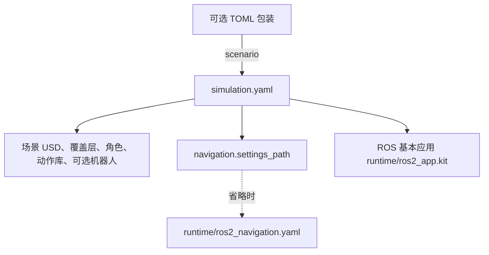

# 配置目录与来源

行人仿真使用 [ROS 2 导航](../docs/ros2_navigation.md)，场景入口为本项目的 `schema_version: 1` YAML。
场景、人数、模型、出生点、路线、速度和停留保存在场景文件，地图与人群参数通过 `navigation.settings_path` 独立维护。

## 内置工程

下列四个工程均已明确声明 `navigation.backend: ros2`，并引用共享的 [runtime/ros2_navigation.yaml](runtime/ros2_navigation.yaml)。
各自原始计划、时长、种子、物理和场景设置由自己的 YAML 维护。`third_3` 明确
`navigation.waypoint_frame: stage_world`；原资产为米制 Z-up，原坐标数字不变。
其余三个入口明确使用 `world_m`；旧配置省略该字段时也保留此兼容合同。运行前用 `check PROJECT` 核对
`navigation.backend` 与 `pedestrian_controller`，行人控制器摘要为 `ros2_sfm_orca`。

| 工程 | 当前人口 | 时长 [仿真 s] | 状态输出 |
|---|---:|---:|---|
| [third](third/README.md) | 3 | 120 | `output/status.json` |
| [third_2](third_2/README.md) | 4 | 60 | `output/status.json` |
| [third_exp](third_exp/README.md) | 4 | 60 | `output/status.json` |
| [third_3](third_3/README.md) | 4 | 60 | `output/status.json` |

人数由未注释的 `actors` 推导；同时声明 `count` 时必须一致。各工程的路线、速度、等待和朝向以自己的 YAML 为准。
功能代码不识别这些目录名。门控、对象路径和覆盖层仅属于对应场景，不能直接复制到不同几何。
这些入口的选择不代表四个场景均已完成 ROS 通行验收，实际结果须绑定本次输入与源码报告。

## 配置依赖关系

ROS 设置是平铺 YAML，包含身体尺寸、栅格、坐标、控制和通信参数。
专用 Kit 只启动场景、PhysX、渲染和独立重定向所需组件，不启用 IRA 或 NavMesh。
完整字段、消息协议和验收边界见 [ROS 设置与执行](../docs/ros2_navigation.md#配置)。
人口与路点字段见[行人 YAML](../docs/pedestrian_yaml.md)。

## 目录与文件分工

| 文件或目录 | 用途 |
|---|---|
| `configs/<工程>/simulation.yaml` | 用户维护的场景、人口、计划及运行配置 |
| `navigation_settings.yaml` | 默认 ROS `init` 生成的项目内参数副本 |
| [runtime/ros2_navigation.yaml](runtime/ros2_navigation.yaml) | ROS 参数文件未明确选择时的包级输入 |
| [runtime/characters.yaml](runtime/characters.yaml) | 内置场景共用的角色资产清单 |
| [runtime/ros2_app.kit](runtime/ros2_app.kit) | 独立 ROS 场景应用，不是用户路线文件 |
| [third_3/headless.toml](third_3/headless.toml) | 复用原 YAML，关闭窗口、视口和录像，写入 `output/headless_status.json` |
| [third_3/recording.toml](third_3/recording.toml) | 复用原 YAML，自动播放，启用视口和 12 FPS 录像 |
| `templates/` | 项目生成输入，不是已生成工程的运行时依赖 |

自己的项目可放在 `configs/my_room` 或仓库之外；`init` 不覆盖已有目录、不复制资产。
CLI 新 ROS 项目明确 `waypoint_frame: stage_world`，位置取已组合的 Isaac WORLD 单位/上轴；
`world_m` 保留规范米制 Z-up 输入。速度、到达容差、地图和相机参数仍用 SI，见[单位合同](../docs/units.md)。
场景路径相对声明它的 YAML；场景名称不参与资源选择。
物理地图要求真实实体碰撞与地面支撑，不能用离线 `check` 代替生成和通行验证。

## 角色资源清单

内置场景的 `pedestrians.assets` 引用共享 [characters.yaml](runtime/characters.yaml)。清单的每个角色 USD 相对于导航配置中的 `asset_root`。迁移机器时，选择包含所列角色与默认动作库的本地 Isaac 资产根，或通过 `--navigation-settings FILE` 选择该机器上的设置。场景 USD 路径仍由各项目独立维护。

自己的项目可以指定单个角色 USD、模型池目录或同格式的角色清单。若旧场景角色通过 USD 包装引用已迁走的绝对目录，可改用清单直接选择 SDK 角色入口。检查声明资源可用 `check PROJECT --dependencies`，运行后核对实际选模与动画。

## 参数来源与优先级

导航参数按 `run` / `workflow` 的 `--navigation-settings FILE`、最终配置的 `navigation.settings_path`、包级 `runtime/ros2_navigation.yaml` 的顺序选择一份文件。
临时参数只作用于本次启动，要求启用行人。重复使用的设置可写入项目 YAML 或 TOML 包装的 `navigation.settings_path`。
选中自己的文件后，遗漏字段使用 `Ros2NavigationSettings` 类型默认值，不逐字段合并包级文件。
共享 ROS 文件的身体半径为 `0.25 m`，额外场景边距为 `0.0275 m`，因此规划、站位和场景扫掠使用 `0.2775 m` 的有效半径。
共享配置的行人间目标净距为 `0.225 m`。自定义文件省略 `map_clearance_m` 或 `pair_clearance_m` 时分别使用 `0.03 m` 和 `0.25 m` 的类型默认值。
选中的文件不存在或字段无效时明确失败，不自动回退。
`asset_root` 与 `ros_setup_path` 属于本机运行环境。依赖详情见[角色资源清单](#角色资源清单)。

## 生成时复制与运行时引用

| 创建方式 | 生成/选择结果 |
|---|---|
| CLI 默认 `init` | 两文件 ROS 工程，明确 `waypoint_frame: stage_world` |
| `--navigation-settings FILE` | ROS 场景直接引用已有设置，不生成副本 |
| Python `create_simulation_project(..., waypoint_frame="stage_world")` | 两文件 ROS 工程，位置采用舞台 WORLD 框架 |

配置不热加载；修改共享文件在下一次加载生效，包级文件修改不会自动同步已有副本。
TOML 包装须通过 `scenario` 引用项目 YAML；先继承再覆盖明确字段，`scene.layers` 追加，`robots=[]` 清空继承机器人。

## 路径与依赖检查

文件内相对路径以声明文件为基准，CLI 路径以当前工作目录为基准；支持绝对路径与 `~`。
`run` / `check` 可接受目录或明确文件；目录只选择本层唯一的 `simulation.yaml` 或 `simulation.toml`。
`headless.toml`、录像包装等其他名字须明确传入，不递归搜索父/子目录。

`check PROJECT --dependencies` 查看声明资源和来源；普通 `check` / `run --dry-run` 还检查输出条件，并报告 ROS 固定出生点的间距诊断。
`pedestrian_parameters` 是补齐默认值后的导航参数，`dependencies.runtime_settings` 给出运行设置来源及声明的资产根。
`dependencies.pedestrian_settings` 给出实际选中的行人参数文件，`ros2_clearance` 汇总规划半径、优选路径半径、固定出生的身体接触阈值和行人间目标中心距 [m]。
声明值不代表 SDK 实际解析结果。离线检查不访问网络、不展开 USD 内部依赖，也不证明物理地图或动画正确。
ROS 的实际输出目录与 namespace 在运行报告中查看。
`workflow PROJECT [--navigation-settings FILE] [--output NEWDIR] [--record/--no-record] [--headless/--no-headless] [--require-route-goals] [--timeout-s S]`
自动串行完成检查、原生运行/录像、坐标 JSON/SVG 与轨迹评估，保存 `workflow_report.json`。
它只为子进程加载配置的 ROS setup，所有产物写入新目录，原 YAML 不改；详见[自动工作流](../docs/workflow.md#自动运行核对与评估)。

旧工程使用的字段和入口调整见[配置迁移](../docs/custom_scenes.md#从旧格式迁移)。
